  

  
  
  
  

<h3 align="center">Bioinformatics, multi-omics and AI solutions for biomedical research, drug discovery and precision health.</h3>

We integrate genomics, transcriptomics, proteomics, clinical data and AI to accelerate discovery and improve human health. Based in London.

---

## What we do

| | Capability | What it means |
|:-:|---|---|
|  | **Omics & multi-omics analysis** | Integrated analysis across molecular layers |
|  | **AI & machine learning** | Turning complex data into predictive insights |
|  | **Biomarker discovery & validation** | Robust markers for precision health |
|  | **Drug discovery & target prioritisation** | Actionable targets, faster discovery |
|  | **Clinical data & biostatistics** | Rigorous statistics for meaningful clinical evidence |
|  | **Public dataset research** | New insights from existing research data |

Explore our [Bioinformatics & AI solutions](https://multiomicsintelligence.co.uk/bioinformatics-ai-solutions), [consultancy](https://multiomicsintelligence.co.uk/consultancy) and [BioOmics Health & Longevity](https://multiomicsintelligence.co.uk/service-bioomics-health).

### How we work

**Discuss** your question and objectives → **Define** the data, scope and deliverables → **Deliver** the analysis or expert guidance → **Review** the findings and next steps.

Every finding can be checked, validated and reproduced before it is reported.

---

## Education: LSMA

  
  
  
  

**LSMA, the London School of Multiomics & AI**, is our education arm. Every free-course project has its own starter repository here: open the project lesson on [lsma.co.uk](https://lsma.co.uk/courses), make your own copy, and an automatic check tells you when each task is right. Each course ends with an **independent project**: you choose the question and the public data, do the analysis yourself and write it up. It is the final lesson and part of earning the free certificate. **Introduction to AI in Healthcare** ends with a 3,000-word essay instead.

New to GitHub? Start with **[lsma-github-practice](https://github.com/MultiOmics-Intelligence/lsma-github-practice)**.

<b>Omics, Bioinformatics and AI</b> · 6 projects + independent project

| Module | Project |
|:-:|---|
| 3 | [FASTQ quality report](https://github.com/MultiOmics-Intelligence/lsma-course-omics-bioinformatics-and-ai-module-3-fastq-quality-report) |
| 4 | [Identify an unknown protein](https://github.com/MultiOmics-Intelligence/lsma-course-omics-bioinformatics-and-ai-module-4-identify-unknown-protein) |
| 5 | [RNA-seq: reads to counts](https://github.com/MultiOmics-Intelligence/lsma-course-omics-bioinformatics-and-ai-module-5-rnaseq-reads-to-counts) |
| 6 | [Genome assembly: coverage and contiguity](https://github.com/MultiOmics-Intelligence/lsma-course-omics-bioinformatics-and-ai-module-6-genome-assembly) |
| 7 | [Gene-set enrichment: from a gene list to biology](https://github.com/MultiOmics-Intelligence/lsma-course-omics-bioinformatics-and-ai-module-7-gene-set-enrichment) |
| 8 | [Protein function prediction](https://github.com/MultiOmics-Intelligence/lsma-course-omics-bioinformatics-and-ai-module-8-protein-function-prediction) |
| Final | [**Independent project**: your own question, public data, an honest report](https://github.com/MultiOmics-Intelligence/lsma-course-omics-bioinformatics-and-ai-independent-project) |

<b>Introduction to Python</b> · 4 projects + independent project

| Module | Project |
|:-:|---|
| 1 | [A sequence and sample report](https://github.com/MultiOmics-Intelligence/lsma-course-introduction-to-python-module-1-sequence-report) |
| 2 | [Honest figures: remake a figure](https://github.com/MultiOmics-Intelligence/lsma-course-introduction-to-python-module-2-honest-figures) |
| 3 | [A tested tool](https://github.com/MultiOmics-Intelligence/lsma-course-introduction-to-python-module-3-tested-tool) |
| 4 | [Predicting diabetes progression](https://github.com/MultiOmics-Intelligence/lsma-course-introduction-to-python-module-4-diabetes-progression-ml) |
| Final | [**Independent project**: your own question, a fair ML analysis, a written report](https://github.com/MultiOmics-Intelligence/lsma-course-introduction-to-python-independent-project) |

<b>Introduction to R</b> · 3 projects + independent project

| Module | Project |
|:-:|---|
| 2 | [Risk factors for low birth weight](https://github.com/MultiOmics-Intelligence/lsma-course-introduction-to-r-module-2-birth-weight-regression) |
| 3 | [Honest figures: remake a figure](https://github.com/MultiOmics-Intelligence/lsma-course-introduction-to-r-module-3-honest-figures) |
| 4 | [Differential expression: counts to results](https://github.com/MultiOmics-Intelligence/lsma-course-introduction-to-r-module-4-differential-expression) |
| Final | [**Independent project**: your own question, honest figures, a reproducible report](https://github.com/MultiOmics-Intelligence/lsma-course-introduction-to-r-independent-project) |

**Professional diplomas** in Cancer Intelligence & AI Drug Discovery, AI, Machine Learning & Data Science, and Longevity Science & AI have private repositories for enrolled students. See [lsma.co.uk](https://lsma.co.uk).

---

## Internship programme: MultiOmicsFlow

<i>Real multi-omics research on public cancer data, built step by step, reviewed at every stage, and presented to the team.</i>

Our interns build a complete, reproducible **multi-omics workflow** on public cancer data (TCGA and GEO), one molecular layer at a time, and learn the habits of careful computational research along the way.

### The project, layer by layer

| Stage | Layer | What interns learn |
|:-:|---|---|
| 1 | **Clinical and genomic data** | Cohort building from GDC and cBioPortal, survival endpoints, mutation processing, patient matching, a survival baseline |
| 2 | **DNA methylation** | Sample and probe filtering, batch and plate checks, methylation as a survival layer |
| 3 | **Bulk RNA-seq** | Quality control, normalisation, differential expression, pathway analysis, RNA as a survival layer |
| 3B | **Single-cell RNA-seq** | Quality control and doublet removal, clustering, cell-type annotation, pseudobulk differential expression, and the link to the bulk RNA results |
| 4 | **Multi-omics integration** | MOFA across mutation, methylation and RNA, interpreting factors, then a presentation of the whole project |
| 5 | **Proteomics** | Protein as a further layer, and in the integration |

Every intern works in their own **private** repository, with a written technical review, ready-made fixes and a step-by-step plan. The same standards apply throughout: everything learned inside the training folds, the same patients and folds for every comparison, an interval for every gain, and a result of no gain reported as plainly as a gain.

### Alongside the project

| Activity | How often | What interns do |
|---|---|---|
| **Weekly Research Intelligence** | Every week | One new paper, one method and one hands-on exercise in R or Python. Interns fork the exercises and keep a record of their answers and plots |
| **Literature review** | One per project | A structured review of their project's question: search, screen, summarise and identify the gap, written up with references |
| **Journal club** | Regular | Interns take turns presenting a recent paper, then the group appraises its design, statistics and claims together |
| **Workshops** | Regular | Hands-on group sessions on core skills, for example an RNA-seq pipeline in Python, GitHub and code review, and reproducible workflows with Docker and Nextflow |
| **Technical reviews** | At each stage | Written feedback on the code and results, with ready-made fixes, before each stage is merged |
| **Presentations** | At key milestones | Interns present their results to the team, and at the end of the programme they present the whole project |
| **Science communication** | Ongoing | Turning results into clear summaries and posts for a wider audience |
| **Research reviews** | During the internship | Referenced written reviews of at least 3,000 words: on the field itself, and on choosing the right AI and machine-learning methods for different types of omics data |
| **Applied mini-projects** | During the internship | Short hands-on projects: building an interactive data-exploration app in Python, and an exploratory bioinformatics analysis using public databases, pathway enrichment and interaction networks |
| **Advanced challenges** | Optional | Open modelling problems that bring together biochemistry, biomarkers and statistics, for interns who want to go further |

All work, from the project to every task, is submitted on GitHub through pull requests and reviewed before it is merged.

### Skills interns build

| Area | Skills |
|---|---|
| **Programming** | Python (pandas, scikit-learn, PyTorch) and R (tidyverse, Bioconductor), clean and tested code, notebooks that run from top to bottom, interactive web apps for exploring data |
| **Bioinformatics** | GDC, cBioPortal and GEO data, mutation (MAF) processing, 450K methylation, DESeq2 and PyDESeq2, GSEA and over-representation analysis, Seurat and Scanpy, MOFA, public compound, pathway and protein-interaction databases, network analysis |
| **Statistics** | Survival analysis (Kaplan–Meier, Cox, C-index), multiple testing and FDR, calibration, confidence intervals, corrected intervals for repeated cross-validation |
| **Machine learning and AI** | Penalised models, random forests and gradient boosting, neural survival models, nested cross-validation without leakage, explainability (SHAP, integrated gradients) |
| **Reproducibility** | Git and GitHub (branches, pull requests, code review), config-driven pipelines, conda and renv, Docker, Nextflow, checksums and data provenance |
| **Research practice** | Literature review, critical appraisal of papers, study design, honest reporting of negative results, data protection with patient data |
| **Communication** | Scientific writing, technical reports, presentations, journal club discussion, and explaining results to a non-specialist audience |
| **Professional skills** | Planning work in stages, agile project management, working from review feedback, and collaborating in a team |

**Interns:** your project and the weekly exercises are listed under [**Internship repositories**](https://github.com/orgs/MultiOmics-Intelligence/repositories?q=topic%3Ainternship). You'll see only the repositories you have access to.

Interested in an internship? Contact **info@lsma.co.uk**.

---

## Research & insights

Weekly scientific updates and in-depth analysis: read this week's [Weekly Research Intelligence](https://multiomicsintelligence.co.uk/research-insights).

## Work with us

What are you working on? [Start a conversation](https://multiomicsintelligence.co.uk/contact-page) about your research question and the support you need, or email us at **info@multiomicsintelligence.co.uk**. Students and course questions: **info@lsma.co.uk**.

  
  
  
  

---

**Dr. Anas Alzaeem** 
Founder & CEO, MultiOmics Intelligence

© 2026 MultiOmics Intelligence Ltd · Science for better health.
